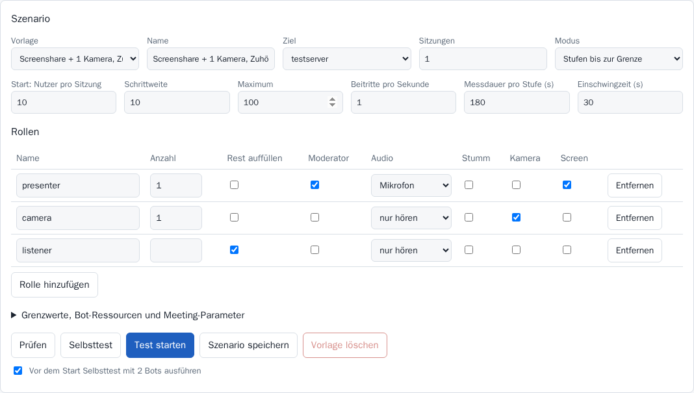
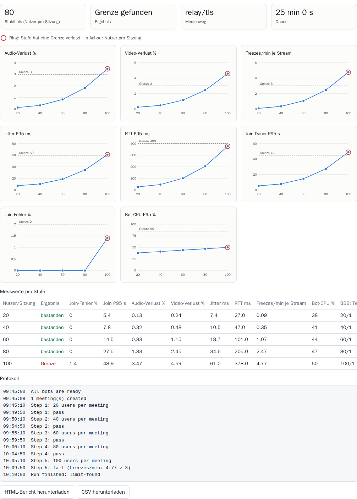
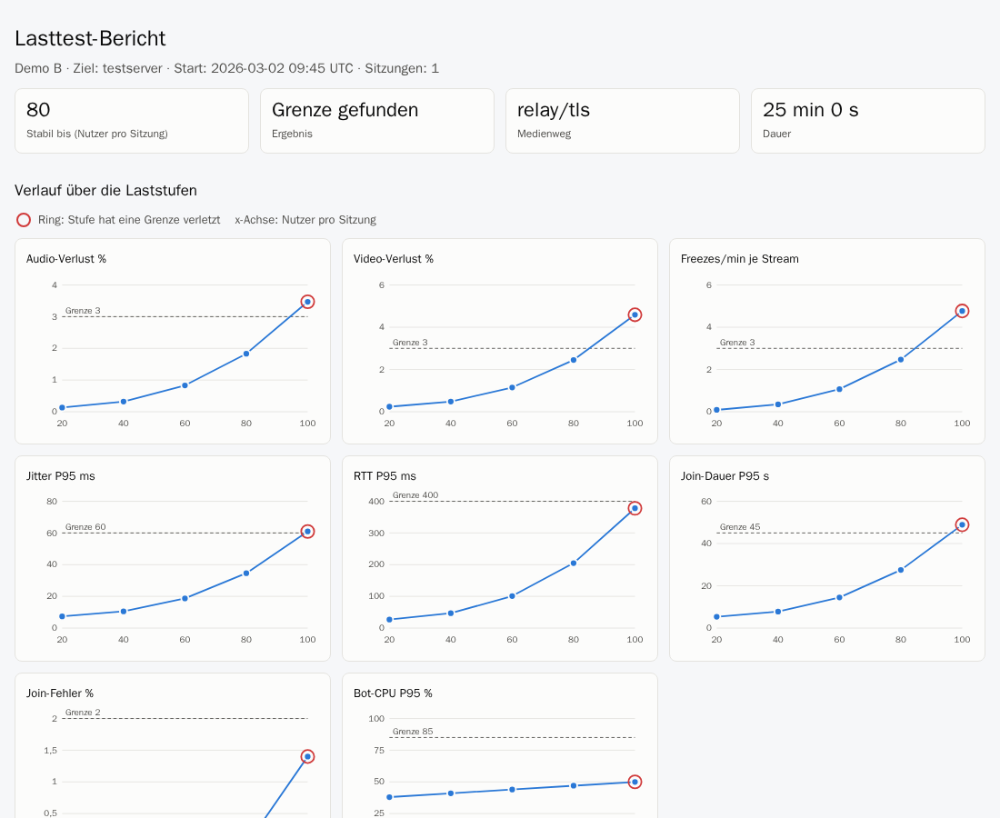
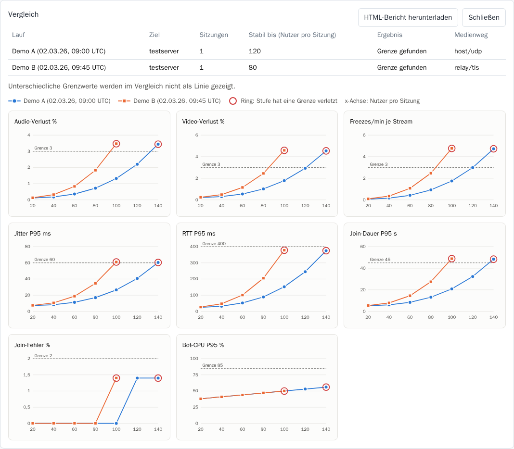
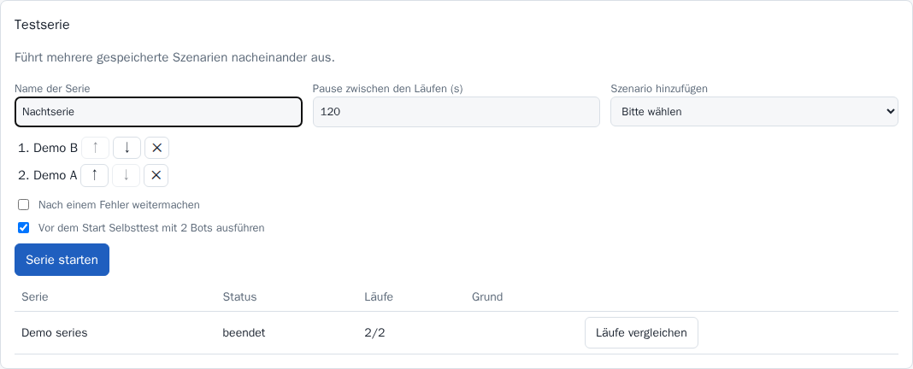
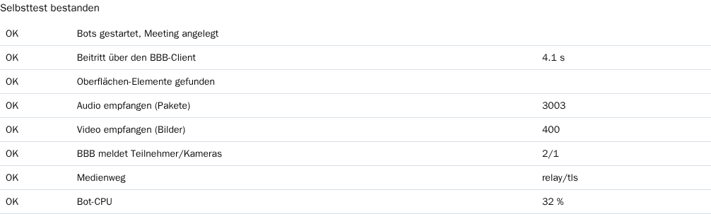

# BBB-Stresstest-Tool

**Deutsch** · [English](README.md)

Lasttests für BigBlueButton mit echten Chromium-Clients. Das Tool startet Sitzungen über die
BBB-API, lässt Bots als Kubernetes-Pods beitreten und findet heraus, ab welcher Nutzerzahl die
Qualität einbricht. Gesteuert wird es über eine Weboberfläche oder per REST-API.

## So arbeitet das Tool

```text
Browser ──> Controller (Web-UI und API, 1 Pod) ──> BBB-API oder Scalelite
                │ legt pro Lauf einen Job an
                ▼
        Bot-Pods (je 1 Chromium) ──> Forward Proxy ──> BBB-Client, TURN
                │ Heartbeat mit WebRTC-Messwerten
                └──> Controller
```

- **Keine Kapazitätsberechnung pro Node:** Jeder Bot ist ein Pod mit festen Ressourcen, Kubernetes
  verteilt sie selbst auf die Nodes.
- **Bots kennen das API-Secret nicht:** Der Controller signiert die Join-Links.
- **Sicherheitsnetze:** Bots beenden sich ohne Controller nach 120 Sekunden selbst. Der Job hat eine
  harte Laufzeitgrenze, und BBB beendet die Sitzungen über den Parameter `duration`.

## Szenarien

Jede Rolle hat eine feste Anzahl oder füllt den Rest der Sitzung auf (`fill: true`).

```yaml
name: Screenshare + 1 Kamera, Zuhörer steigern
target: testserver
meetings: 1
roles:
  - { name: presenter, count: 1, moderator: true, audio: microphone, screenshare: true }
  - { name: camera, count: 1, audio: listen, webcam: true }
  - { name: listener, fill: true, audio: listen }
load: { mode: steps, startUsers: 10, stepUsers: 10, maxUsers: 100, joinPerSecond: 1, holdSeconds: 180 }
```

Vorlagen liegen in [scenarios/](scenarios/). Alle Werte lassen sich in der Oberfläche ändern.
Die Oberfläche gibt es auf Deutsch und Englisch, die Sprache folgt dem Browser und lässt sich oben rechts
umstellen. Laufprotokolle, Gründe und API-Fehler kommen vom Server, ihre Sprache setzt `language` (`de` oder
`en`, Standard `en`) in der Konfiguration.

| Feld | Bedeutung |
|---|---|
| `load.mode: steps` | Erhöht die Nutzerzahl stufenweise und stoppt bei der ersten verletzten Grenze |
| `load.mode: fixed` | Hält eine feste Last für die Messdauer |
| `meeting.createParams` | Parameter für `/create`, z. B. `audioBridge`, `cameraBridge`, `screenShareBridge` in v4 |
| `meeting.presentationFile` | Datei, die beim Anlegen mitgeschickt wird (Name und Base64, in der Oberfläche per Datei-Auswahl) |
| `meeting.presentationUrl` | Alternative zur Datei: URL, die BBB selbst abruft. BBB lehnt private Adressen ab |
| `roles[].muted` | Mikrofon bleibt stumm. Standard ist freigeschaltet, sonst fehlt die Last der Audio-Mischung |
| `roles[].nextSlideEverySeconds` | Der Presenter blättert im angegebenen Abstand weiter |
| `slo` | Grenzwerte pro Stufe, optional auch Prometheus-Abfragen |
| `bot` | CPU, RAM und `/dev/shm` pro Bot |

### Ergebnis einer Stufe

| Ergebnis | Bedeutung |
|---|---|
| bestanden | Alle Grenzwerte eingehalten |
| Grenze | Grenzwert verletzt, erwartete Medien fehlen oder BBB meldet andere Teilnehmer- oder Kamerazahlen. Der Lauf endet |
| ungültig | Die Bots selbst waren überlastet, die Stufe sagt nichts über BBB aus |

`getMeetingInfo` meldet in BBB 3 und 4 bei `listenerCount` 0, reine Zuhörer zählen als Voice-Teilnehmer. Das
Tool prüft deshalb nur Teilnehmer und Kameras.

Serverlast kommt als Prometheus-Regel in die Bewertung:

```yaml
slo:
  prometheus:
    - name: BBB-CPU %
      query: 100 - avg(rate(node_cpu_seconds_total{mode="idle",instance=~"bbb-test.*"}[1m])) * 100
      max: 85
```

## Berichte und Ergebnisse

### Steuerungstool



### Ein einzelner Lauf

Jeder beendete Lauf zeigt die stabile Nutzerzahl, Diagramme über die Laststufen, die Tabelle aller Messwerte, das
Protokoll und seine Downloads. Jedes Diagramm zeigt eine Kennzahl über die Nutzer pro Sitzung. Eine gestrichelte Linie
markiert den Grenzwert, ein Ring markiert eine Stufe, die eine Grenze verletzt hat. Mit dem Mauszeiger oder den
Pfeiltasten lassen sich die Werte ablesen.



- **HTML-Bericht:** Eine eigenständige Datei mit allen Daten, Diagrammen und dem Protokoll. Sie funktioniert offline,
  lässt sich drucken und an Tickets oder Mails anhängen.
- **CSV:** Die Stufenwerte für Excel oder LibreOffice.
- **Prometheus-Regeln:** Jede Regel aus `slo.prometheus` bekommt ein eigenes Diagramm.
- **Einzelne Laststufe:** Ein Lauf im Modus `fixed` hat keinen Verlauf, seine Werte stehen daher ohne Diagramme in der
  Tabelle.



### Läufe vergleichen

2 bis 8 Läufe auswählen und *Auswahl vergleichen* wählen. Alle Läufe teilen sich ein Diagramm pro Kennzahl, jeder mit
eigener Farbe und Markerform. Ein Grenzwert erscheint nur, wenn er für alle verglichenen Läufe gleich ist. Den Vergleich
gibt es auch als HTML-Bericht.



### Testserien

Eine Serie führt gespeicherte Szenarien nacheinander mit einer Pause dazwischen aus. Vor dem ersten Lauf werden alle
Szenarien geprüft, damit ein fehlerhaftes nicht erst nach Stunden scheitert. Standardmäßig endet eine Serie, wenn ein Lauf
mit einem Fehler endet. *Grenze gefunden* und *ungültig* halten sie nicht an. Danach öffnet *Läufe vergleichen* den
Vergleich.



Mit `backend.type: external` müssen Bots für jeden Lauf einer Serie gestartet werden, das ist für Tests gedacht. Auf
Kubernetes erledigt das der Controller selbst.

Die Screenshots zeigen erfundene Beispieldaten aus [dev/screenshots/](dev/screenshots/), keine Messungen.

### Prometheus und Grafana

`/metrics` liefert gleitende Werte der letzten Minute pro Lauf, mit den Labels `run`, `scenario` und `target`. Die Werte
gibt es, solange ein Lauf aktiv ist, und 30 Sekunden danach.

| Metrik | Bedeutung |
|---|---|
| `bbb_stress_users_per_meeting` | Aktuelle Laststufe |
| `bbb_stress_stable_users` | Höchste bestandene Stufe |
| `bbb_stress_bots{state}` | Bots nach Zustand |
| `bbb_stress_audio_loss_percent`, `bbb_stress_video_loss_percent` | Paketverlust |
| `bbb_stress_jitter_p95_milliseconds`, `bbb_stress_rtt_p95_milliseconds` | Jitter und Laufzeit |
| `bbb_stress_freezes_per_minute` | Video-Freezes pro Stream und Minute |
| `bbb_stress_join_p95_seconds`, `bbb_stress_join_failure_percent` | Beitritte |
| `bbb_stress_bot_cpu_p95_percent`, `bbb_stress_bot_throttled_p95_percent` | Last der Generatoren |

Das Chart enthält ein [Grafana-Dashboard](deploy/helm/bbb-stress-tool/dashboards/bbb-stress.json) mit diesen Werten sowie
CPU und Netz des BBB-Servers aus dem Node Exporter auf einer Zeitachse. So wird es installiert:

```sh
helm upgrade --install bbb-stress deploy/helm/bbb-stress-tool -n NAMESPACE --reuse-values \
  --set serviceMonitor.enabled=true \
  --set grafanaDashboard.enabled=true --set grafanaDashboard.namespace=cattle-dashboards
```

Der Grafana-Sidecar übernimmt ConfigMaps mit dem Label `grafana_dashboard: "1"`. Alternativ lässt sich die JSON-Datei von
Hand importieren. Mit `grafanaUrl: https://grafana.example.org/d/bbb-stress` in der Konfiguration bekommt jeder Lauf einen
Link *In Grafana öffnen* mit passendem Zeitraum und Lauf.

## Selbsttest und Selektor-Check

### Selbsttest

Bevor viele Pods starten, prüfen zwei Bots den gesamten Weg zum Ziel. Der Selbsttest dauert etwa eine Minute und läuft
über *Selbsttest* in der Oberfläche. Start und Testserie führen ihn standardmäßig zuerst aus. Schlägt er fehl, beginnt
kein Lasttest.

| Prüfung | Was sie belegt |
|---|---|
| Bots gestartet, Meeting angelegt | Pods laufen, API-URL, Secret und Proxy stimmen |
| Beitritt über den BBB-Client | Der Client lädt, die Stufe im Fehler nennt die Stelle |
| Oberflächen-Elemente gefunden | Die Selektoren der Bots passen zu diesem Server |
| Audio und Video empfangen | Medien fließen wirklich in beide Richtungen |
| BBB meldet Teilnehmer/Kameras | Der Server sieht die Bots wie erwartet |
| Medienweg | Mit gesetztem `webrtcIpPolicy` zählt nur `relay` als bestanden |
| Bot-CPU | Die Bots haben genug Ressourcen |



### Selektor-Check

BBB ändert seinen Client zwischen den Versionen. `scripts/check-selectors.mjs` vergleicht die Selektoren und
Join-Parameter der Bots mit den offiziellen Playwright-Tests von BBB, ganz ohne Server:

```sh
node scripts/check-selectors.mjs                 # neueste stabile Version jeder Linie ab 3.0
node scripts/check-selectors.mjs v3.0.40 v4.0.1  # bestimmte Versionen
```

Fehlt etwas, endet es mit einem Fehler. [.github/workflows/selector-check.yml](.github/workflows/selector-check.yml)
führt es jeden Montag aus und wenn sich die Selektoren ändern. Die Selektoren stehen in
[src/bot/selectors.ts](src/bot/selectors.ts).

## Netzwerk ohne UDP

Die Medien laufen über TURN durch den Forward Proxy. Pro Ziel wird das so konfiguriert:

```yaml
targets:
  testserver:
    apiUrl: https://scalelite.example.org/bigbluebutton/api
    secret: GEHEIM
    proxy:
      server: http://proxy.example.org:3128
      # username und password sind optional
    webrtcIpPolicy: disable_non_proxied_udp
```

Geprüft mit dem echten Client in einem Netz, dessen einziger Weg nach außen ein Squid-Proxy war:

| Version | Medienweg | Ports am Proxy | Änderung am Server |
|---|---|---|---|
| BBB 4.0.1 (LiveKit) | `relay/tls` | 443 | Keine, das eingebaute TURN genügte |
| BBB 3.0.40 (mediasoup, FreeSWITCH) | `relay/tls` | 443 | Keine, das eingebaute TURN genügte |

Voraussetzungen:

1. **BBB liefert TURN über TLS aus:** Eine normale `bbb-install`-Installation bringt `turns:HOST:443` in beiden
   Versionen mit. Bei eigenen Setups das prüfen, der Selbsttest zeigt den Medienweg.
2. **Der Proxy erlaubt CONNECT:** Die Hosts von BBB, Scalelite und TURN sowie deren Ports müssen freigegeben
   sein, auch für Ports außer 443.
3. **Keine TLS-Inspektion:** Der Proxy darf TURN-Verbindungen nicht aufbrechen. Das wurde nicht getestet und
   gilt als wahrscheinlich problematisch.
4. **Genug Tunnel:** Jede WebRTC-Verbindung nutzt eigene CONNECT-Tunnel. In einem Lauf mit nur 4 Nutzern
   protokollierte Squid rund 60 bis 75 Tunnel, bei BBB 3 hat jeder empfangene Videostream eine eigene
   Verbindung. Große Sitzungen brauchen also einen entsprechend ausgelegten Proxy.

**Grenzen dieser Messung:** Proxy und TURN gehören dann zur getesteten Strecke und können selbst der
Engpass sein. TCP versteckt Paketverlust, deshalb zählen dort Freezes, RTT und Serverlast stärker als die
Verlustrate. Der Bericht zeigt den Medienweg pro Stufe. Für reine Kapazitätsaussagen über BBB ist eine
UDP-Freigabe aussagekräftiger.

## Scalelite und PILOS

- **Direkter BBB-Server:** Für die Frage nach der Grenze eines Servers ist das die klarste Messung.
- **Scalelite:** `apiUrl` zeigt auf Scalelite, `secret` ist das `LOADBALANCER_SECRET`. Scalelite wählt den
  Server. Bei mehreren Sitzungen verteilt sich die Last daher auf den Pool.
- **PILOS:** Wird nicht benötigt und nicht mitgetestet, weil das Tool direkt die BBB-API nutzt.

## BBB 3 und BBB 4

Die Bot-Selektoren stammen aus den offiziellen Playwright-Tests und wurden gegen echte Server mit v3.0.40 und
v4.0.1 geprüft. Sie stehen nur in [src/bot/selectors.ts](src/bot/selectors.ts). v3 und v4 lassen sich nicht direkt vergleichen, weil v4
standardmäßig LiveKit statt mediasoup und FreeSWITCH nutzt. Für einen fairen Vergleich kann ein
v4-Szenario über `createParams` die alte Medienstrecke wählen:

```yaml
meeting:
  createParams:
    audioBridge: bbb-webrtc-sfu
    cameraBridge: bbb-webrtc-sfu
    screenShareBridge: bbb-webrtc-sfu
```

## Bereitstellung aus Git

### 1. Images bauen

```sh
docker build --target controller -t REGISTRY/bbb-stress/controller:0.3.0 .
docker build --target bot -t REGISTRY/bbb-stress/bot:0.3.0 .
docker push REGISTRY/bbb-stress/controller:0.3.0
docker push REGISTRY/bbb-stress/bot:0.3.0
```

### 2. Konfiguration als Secret anlegen

Geheimnisse gehören nicht ins Repo. Vorlage:

```yaml
adminToken: "<openssl rand -hex 24>"
language: de
publicUrl: http://bbb-stress.NAMESPACE.svc:8080
prometheusUrl: http://prometheus.example:9090
targets:
  testserver:
    apiUrl: https://bbb-test.example.org/bigbluebutton/api
    secret: "<bbb-conf --secret>"
    checksum: sha256
    proxy: { server: http://proxy.example.org:3128 }
    webrtcIpPolicy: disable_non_proxied_udp
backend:
  type: kubernetes
  namespace: NAMESPACE
  image: REGISTRY/bbb-stress/bot:0.3.0
```

```sh
kubectl -n NAMESPACE create secret generic bbb-stress-config --from-file=config.yaml
```

Nutzt BBB ein Zertifikat einer internen CA, kommt diese als Secret mit dem Schlüssel `ca.crt` dazu und wird
über `caSecret` eingebunden. Für die Bots gibt es `ignoreTlsErrors: true` pro Ziel.

### 3. Chart installieren

```sh
helm upgrade --install bbb-stress deploy/helm/bbb-stress-tool -n NAMESPACE \
  --set existingSecret=bbb-stress-config \
  --set image.controller=REGISTRY/bbb-stress/controller:0.3.0 \
  --set image.bot=REGISTRY/bbb-stress/bot:0.3.0 \
  --set ingress.enabled=true --set ingress.host=bbb-stress.example.org
```

In Rancher lässt sich das Chart auch über ein Git-Repository unter *Apps → Repositories* einbinden.

**Hinweis zum Secret:** Mit `existingSecret` muss das Secret alle Pflichtfelder enthalten, also auch den
Block `backend`.

### Rechte im Cluster

Das Tool braucht nur Rechte im eigenen Namespace: Jobs anlegen und löschen sowie ResourceQuotas lesen.
Alle Pods laufen nach dem Profil `restricted` mit `readOnlyRootFilesystem`. Chromium läuft mit
`--no-sandbox`, wie die offiziellen BBB-Tests auch, und öffnet nur den konfigurierten BBB-Server.

### Empfehlungen für aussagekräftige Messungen

- **Eigene Nodes:** Mit `bots.nodeSelector` und `bots.tolerations` einen Pool reservieren.
- **Kalibrieren:** Vor großen Läufen ein kleines Szenario je Rolle fahren und `bot.cpu` anpassen. Die
  Standardwerte 2 vCPU und 3 GiB sind Schätzwerte. Gemessen wurden rund 0,8 vCPU pro Bot bei 6 Nutzern mit
  5 Kameras in BBB 3 und rund 1 vCPU in BBB 4. Der Wert steigt mit der Zahl der Videos.
- **Host-Last:** `bot.cpu` als Request und Limit schützt die Messung, das Tool sieht aber nur die CPU des eigenen
  Containers. Eine überbuchte Node erkennt es nicht, deshalb Node-Metriken in Grafana mitbeobachten.
- **Join-Rate:** Die Rate gering halten, außer wenn gezielt ein Join-Sturm getestet wird. Sonst
  mischen sich Beitrittslast und Dauerlast in der Messung.

### Bots aus einem anderen Cluster

Mit `backend.type: external` startet der Controller keine Pods. Bots können dann überall laufen und
brauchen nur `CONTROLLER_URL`, `RUN_ID` und `BOT_TOKEN`. Der Controller muss dafür per Ingress mit TLS
erreichbar sein. `POST /api/runs` liefert das Token zurück.

## Status

Geprüft gegen echte Server mit BBB 3.0.40 und 4.0.1 mit bis zu 6 Bots, direkt und über einen Forward Proxy
ohne direkten Netzweg. Auch der Selbsttest lief dort, einschließlich eines Ziels mit falschem Secret. PDF-Upload und Blättern wurden nur auf 4.0.1 geprüft.

Noch nicht geprüft:

- Betrieb auf einem echten Kubernetes-Cluster. Das Chart wurde nur statisch geprüft, die Einschränkungen von
  `restricted` wurden in Containern nachgestellt. Das gilt auch für das Grafana-Dashboard, das noch nie in einem echten
  Grafana geladen wurde.
- Berichte, Vergleich, Testserien und `/metrics` wurden nur gegen `fake-bbb` getestet, nicht gegen einen echten BBB-Server.
- Große Läufe, Scalelite, Proxy-Anmeldung und TLS-Inspektion am Proxy.
- Blättern auf der Standard-PDF von BBB: Im einzigen Lauf blieb die Folie auf Seite 1, auf eigener PDF funktionierte es.

## Entwicklung

Alles läuft in Containern, lokal wird nichts installiert. `node_modules` liegt in einem Podman-Volume.

```sh
dev/node.sh npm install --ignore-scripts
dev/node.sh npm test
dev/node.sh npm run typecheck
dev/check-chart.sh                 # Chart nur statisch prüfen
dev/e2e.sh "$PWD/dev/e2e-config.yaml" dev/e2e-scenario.json 3   # Lauf gegen fake-bbb
dev/e2e-series.sh "$PWD/dev/e2e-config.yaml" dev/e2e-scenario.json   # Testserie gegen fake-bbb
dev/screenshots/run.sh             # Weboberfläche prüfen, docs/screenshots schreiben
node scripts/check-selectors.mjs   # Selektoren mit den BBB-Tests vergleichen
dev/proxy-spike/run.sh             # WebRTC durch Forward Proxy
```

`fake-bbb` prüft Checksummen und nutzt echtes WebRTC, ersetzt aber keinen BBB-Server. Es belegt nur die
Werkzeugkette.
