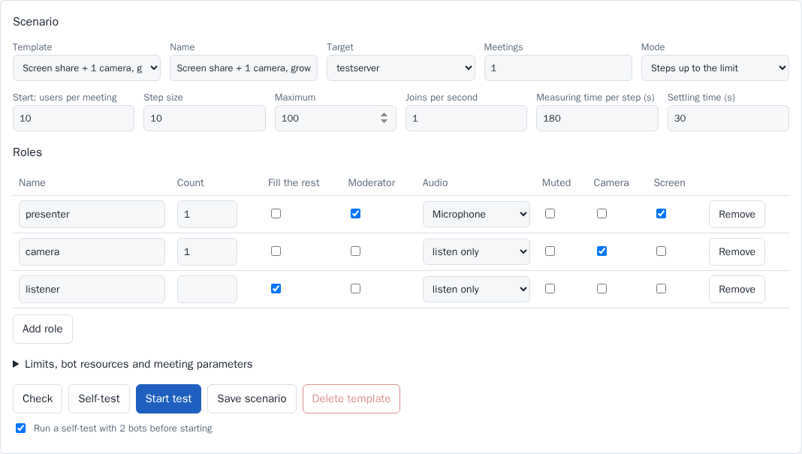
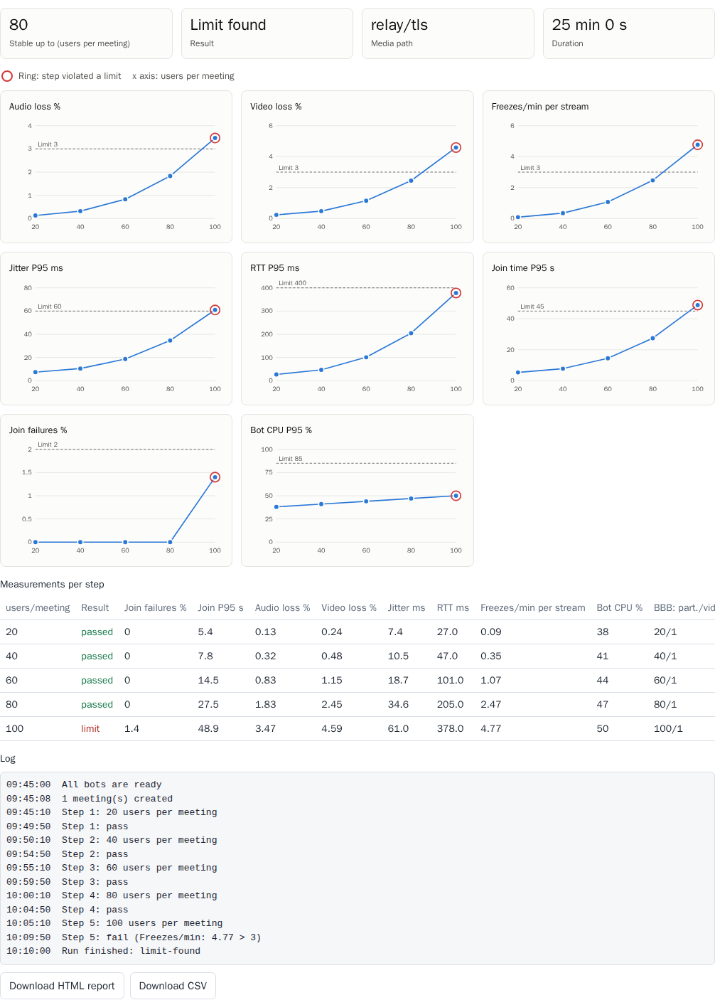
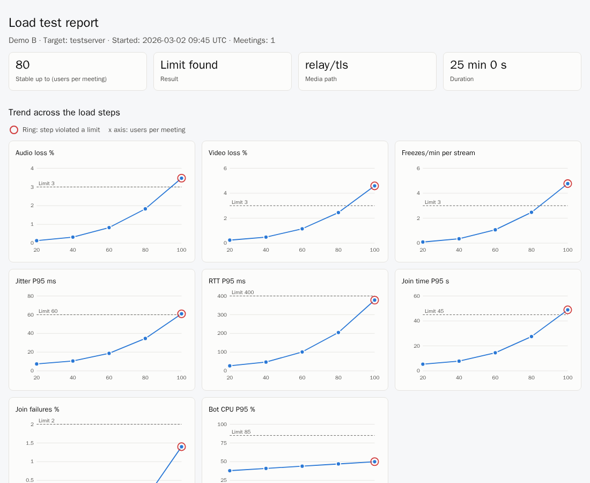
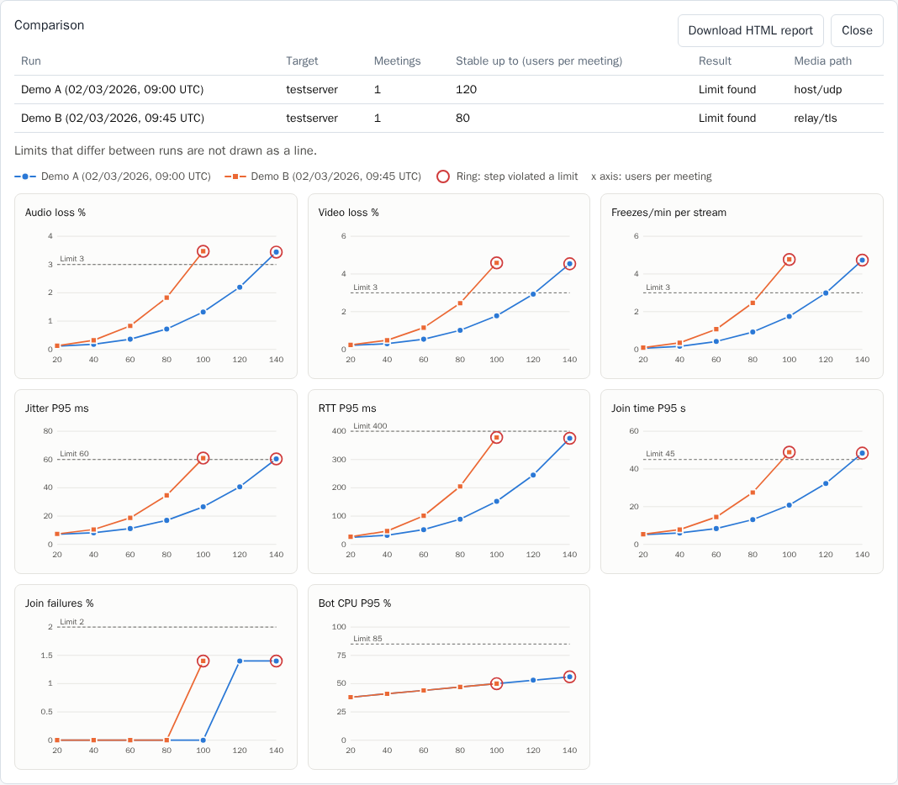
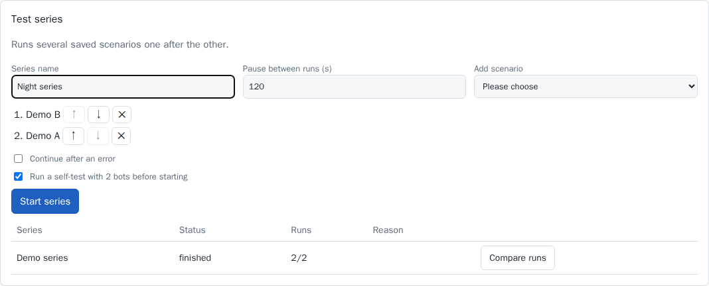
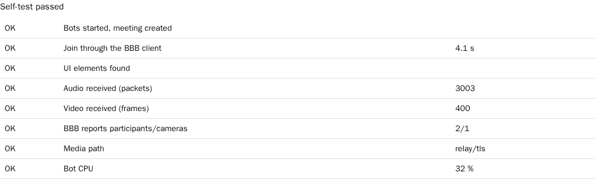

# BBB Stress Test Tool

[Deutsch](README.de.md) · **English**

Load tests for BigBlueButton with real Chromium clients. The tool creates meetings through the BBB API,
lets bots join as Kubernetes pods and finds out at which user count the quality breaks down. You control it
through a web UI or the REST API.

## How it works

```text
Browser ──> Controller (web UI and API, 1 pod) ──> BBB API or Scalelite
                │ creates one job per run
                ▼
        Bot pods (1 Chromium each) ──> Forward proxy ──> BBB client, TURN
                │ heartbeat with WebRTC measurements
                └──> Controller
```

- **No capacity calculation per node:** Each bot is a pod with fixed resources, Kubernetes places them on the
  nodes.
- **Bots do not know the API secret:** The controller signs the join links.
- **Safety nets:** Without a controller, bots exit on their own after 120 seconds. The job has a hard time
  limit, and BBB ends the meetings through the `duration` parameter.

## Scenarios

Each role has a fixed count or fills the rest of the meeting (`fill: true`).

```yaml
name: Screen share + 1 camera, growing audience
target: testserver
meetings: 1
roles:
  - { name: presenter, count: 1, moderator: true, audio: microphone, screenshare: true }
  - { name: camera, count: 1, audio: listen, webcam: true }
  - { name: listener, fill: true, audio: listen }
load: { mode: steps, startUsers: 10, stepUsers: 10, maxUsers: 100, joinPerSecond: 1, holdSeconds: 180 }
```

Templates are in [scenarios/](scenarios/). You can change every value in the UI. The UI is available in English
and German, follows the browser language and can be switched at the top right. Run logs, reasons and API errors
come from the server, and `language` (`de` or `en`, default `en`) in the configuration sets their language.

| Field | Meaning |
|---|---|
| `load.mode: steps` | Raises the user count step by step and stops at the first violated limit |
| `load.mode: fixed` | Holds a fixed load for the measuring time |
| `meeting.createParams` | Parameters for `/create`, e.g. `audioBridge`, `cameraBridge`, `screenShareBridge` in v4 |
| `meeting.presentationFile` | File sent along when creating the meeting (name and Base64, a file picker in the UI) |
| `meeting.presentationUrl` | Alternative to the file: a URL BBB fetches itself. BBB rejects private addresses |
| `roles[].muted` | Keeps the microphone muted. The default is unmuted, otherwise the audio mixing load is missing |
| `roles[].nextSlideEverySeconds` | The presenter moves to the next slide in this interval |
| `slo` | Limits per step, optionally with Prometheus queries |
| `bot` | CPU, RAM and `/dev/shm` per bot |

### Result of a step

| Result | Meaning |
|---|---|
| passed | All limits were met |
| limit | A limit was violated, expected media is missing, or BBB reports other participant or camera counts. The run ends |
| invalid | The bots themselves were overloaded, the step says nothing about BBB |

In BBB 3 and 4, `getMeetingInfo` reports `listenerCount` 0 and counts pure listeners as voice participants. The
tool therefore only checks participants and cameras.

Server load enters the evaluation as a Prometheus rule:

```yaml
slo:
  prometheus:
    - name: BBB CPU %
      query: 100 - avg(rate(node_cpu_seconds_total{mode="idle",instance=~"bbb-test.*"}[1m])) * 100
      max: 85
```

## Reports and results

### Control tool



### One run

Each finished run shows the stable user count, charts across the load steps, the table of all measurements, the log
and its downloads. Each chart holds one measure against the users per meeting. A dashed line marks the limit, and a
ring marks a step that violated a limit. Moving the pointer or using the arrow keys on a chart shows the values.



- **HTML report:** One self-contained file with all data, charts and the log. It works offline and prints well, and
  can be attached to a ticket or mail.
- **CSV:** The step values for Excel or LibreOffice.
- **Prometheus rules:** Each rule from `slo.prometheus` gets its own chart.
- **Single load step:** A run in `fixed` mode has no trend, so its values appear as a table without charts.



### Comparing runs

Select 2 to 8 runs and choose *Compare selection*. All runs share one chart per measure, each with its own color and
marker shape. A limit is only drawn if all compared runs share it. The comparison is available as an HTML report too.



### Test series

A series runs saved scenarios one after the other with a pause in between. Before the first run, all scenarios are
checked, so a broken one does not fail after hours. By default, a series ends when a run ends with an error. *Limit
found* and *invalid* do not stop it. Afterwards, *Compare runs* opens the comparison.



With `backend.type: external`, bots must be started for each run of a series, which is meant for tests. On Kubernetes
the controller does this by itself.

The screenshots use invented sample data from [dev/screenshots/](dev/screenshots/), not measurements.

### Prometheus and Grafana

`/metrics` delivers rolling values of the last minute per run, with the labels `run`, `scenario` and `target`. The
values exist while a run is active and for 30 seconds after it.

| Metric | Meaning |
|---|---|
| `bbb_stress_users_per_meeting` | Current load step |
| `bbb_stress_stable_users` | Highest step that passed |
| `bbb_stress_bots{state}` | Bots by state |
| `bbb_stress_audio_loss_percent`, `bbb_stress_video_loss_percent` | Packet loss |
| `bbb_stress_jitter_p95_milliseconds`, `bbb_stress_rtt_p95_milliseconds` | Jitter and round trip time |
| `bbb_stress_freezes_per_minute` | Video freezes per stream and minute |
| `bbb_stress_join_p95_seconds`, `bbb_stress_join_failure_percent` | Joins |
| `bbb_stress_bot_cpu_p95_percent`, `bbb_stress_bot_throttled_p95_percent` | Load of the generators |

The chart contains a [Grafana dashboard](deploy/helm/bbb-stress-tool/dashboards/bbb-stress.json) with these values and
the BBB server's CPU and network from the node exporter on one timeline. To install it:

```sh
helm upgrade --install bbb-stress deploy/helm/bbb-stress-tool -n NAMESPACE --reuse-values \
  --set serviceMonitor.enabled=true \
  --set grafanaDashboard.enabled=true --set grafanaDashboard.namespace=cattle-dashboards
```

The Grafana sidecar picks up ConfigMaps with the label `grafana_dashboard: "1"`. Alternatively, import the JSON file by
hand. With `grafanaUrl: https://grafana.example.org/d/bbb-stress` in the configuration, each run gets an *Open in
Grafana* link with the matching time range and run.

## Self-test and selector check

### Self-test

Before many pods start, two bots prove the whole path to a target. The self-test takes about a minute and runs on
*Self-test* in the UI. Start and series run it first by default, and if it fails, no load test starts.

| Check | What it proves |
|---|---|
| Bots started, meeting created | Pods run, API URL, secret and proxy work |
| Join through the BBB client | The client loads, the stage in the error names the failed spot |
| UI elements found | The selectors of the bots match this server |
| Audio and video received | Media really flows in both directions |
| BBB reports participants/cameras | The server sees the bots as expected |
| Media path | With `webrtcIpPolicy` set, only `relay` counts as passed |
| Bot CPU | The bots have enough resources |



### Selector check

BBB changes its client between releases. `scripts/check-selectors.mjs` compares the selectors and join parameters of
the bots with BBB's official Playwright tests, without needing a server:

```sh
node scripts/check-selectors.mjs                 # newest stable release of each line from 3.0 on
node scripts/check-selectors.mjs v3.0.40 v4.0.1  # specific releases
```

It exits with an error if something is missing. To run it every Monday and when the selectors change, copy
[dev/github-workflows/selector-check.yml](dev/github-workflows/selector-check.yml) to `.github/workflows/`. Pushing that
needs a token with the *Workflows* permission. The selectors live in [src/bot/selectors.ts](src/bot/selectors.ts).

## Networks without UDP

Media runs over TURN through the forward proxy. Configure it per target:

```yaml
targets:
  testserver:
    apiUrl: https://scalelite.example.org/bigbluebutton/api
    secret: SECRET
    proxy:
      server: http://proxy.example.org:3128
      # username and password are optional
    webrtcIpPolicy: disable_non_proxied_udp
```

Tested with the real client in a network whose only way out was a Squid proxy:

| Version | Media path | Ports at the proxy | Server change |
|---|---|---|---|
| BBB 4.0.1 (LiveKit) | `relay/tls` | 443 | None, the built-in TURN was enough |
| BBB 3.0.40 (mediasoup, FreeSWITCH) | `relay/tls` | 443 | None, the built-in TURN was enough |

Requirements:

1. **BBB offers TURN over TLS:** A default `bbb-install` provides `turns:HOST:443` in both versions. Check this if
   your server uses a custom setup. The self-test shows the media path.
2. **The proxy allows CONNECT:** The hosts of BBB, Scalelite and TURN and their ports must be allowed, also for
   ports other than 443.
3. **No TLS inspection:** The proxy must not break open TURN connections. This was not tested and is likely to
   cause problems.
4. **Enough tunnels:** Each WebRTC connection uses its own CONNECT tunnels. In a run with only 4 users, Squid
   logged about 60 to 75 tunnels, and in BBB 3 each received video stream has its own connection. Large
   meetings need a proxy sized accordingly.

**Limits of this measurement:** Proxy and TURN become part of the tested path and can be the bottleneck
themselves. TCP hides packet loss, so freezes, RTT and server load matter more there than the loss rate. The
report shows the media path per step. For pure capacity statements about BBB, opening UDP is more meaningful.

## Scalelite and PILOS

- **Direct BBB server:** This is the clearest measurement of the limit of one server.
- **Scalelite:** `apiUrl` points to Scalelite and `secret` is the `LOADBALANCER_SECRET`. Scalelite picks the
  server, so several meetings spread across the pool.
- **PILOS:** Not needed and not tested, because the tool uses the BBB API directly.

## BBB 3 and BBB 4

The bot selectors come from the official Playwright tests and were checked against real servers with v3.0.40 and
v4.0.1. They live only in [src/bot/selectors.ts](src/bot/selectors.ts). v3 and v4 are not directly comparable, because
v4 uses LiveKit instead of mediasoup and FreeSWITCH by default. For a fair comparison, a v4 scenario can select
the old media path through `createParams`:

```yaml
meeting:
  createParams:
    audioBridge: bbb-webrtc-sfu
    cameraBridge: bbb-webrtc-sfu
    screenShareBridge: bbb-webrtc-sfu
```

## Deployment from Git

### 1. Build the images

```sh
docker build --target controller -t REGISTRY/bbb-stress/controller:0.3.0 .
docker build --target bot -t REGISTRY/bbb-stress/bot:0.3.0 .
docker push REGISTRY/bbb-stress/controller:0.3.0
docker push REGISTRY/bbb-stress/bot:0.3.0
```

### 2. Create the configuration as a secret

Secrets do not belong in the repo. Template:

```yaml
adminToken: "<openssl rand -hex 24>"
language: en
publicUrl: http://bbb-stress.NAMESPACE.svc:8080
prometheusUrl: http://prometheus.example:9090
targets:
  testserver:
    apiUrl: https://bbb-test.example.org/bigbluebutton/api
    secret: "<bbb-conf --secret>"
    checksum: sha256
    proxy: { server: http://proxy.example.org:3128 }
    webrtcIpPolicy: disable_non_proxied_udp
backend:
  type: kubernetes
  namespace: NAMESPACE
  image: REGISTRY/bbb-stress/bot:0.3.0
```

```sh
kubectl -n NAMESPACE create secret generic bbb-stress-config --from-file=config.yaml
```

If BBB uses a certificate of an internal CA, add the CA as a secret with the key `ca.crt` and reference it through
`caSecret`. For the bots, each target has `ignoreTlsErrors: true`.

### 3. Install the chart

```sh
helm upgrade --install bbb-stress deploy/helm/bbb-stress-tool -n NAMESPACE \
  --set existingSecret=bbb-stress-config \
  --set image.controller=REGISTRY/bbb-stress/controller:0.3.0 \
  --set image.bot=REGISTRY/bbb-stress/bot:0.3.0 \
  --set ingress.enabled=true --set ingress.host=bbb-stress.example.org
```

In Rancher, you can also add the chart through a Git repository under *Apps → Repositories*.

**Note on the secret:** With `existingSecret`, the secret must contain all required fields, including the
`backend` block.

### Cluster permissions

The tool only needs rights in its own namespace: creating and deleting jobs and reading ResourceQuotas. All pods
follow the `restricted` profile with `readOnlyRootFilesystem`. Chromium runs with `--no-sandbox`, as the official
BBB tests do, and only opens the configured BBB server.

### Recommendations for meaningful measurements

- **Dedicated nodes:** Reserve a pool with `bots.nodeSelector` and `bots.tolerations`.
- **Calibrate:** Before large runs, run a small scenario per role and adjust `bot.cpu`. The defaults of 2 vCPU and
  3 GiB are estimates. Measured were about 0.8 vCPU per bot with 6 users and 5 cameras in BBB 3 and about 1 vCPU in
  BBB 4. The value rises with the number of videos.
- **Host load:** `bot.cpu` as request and limit protects the measurement, but the tool only sees the CPU of its own
  container. It does not detect an overbooked node, so watch the node metrics in Grafana as well.
- **Join rate:** Keep the rate low unless you test a join storm on purpose. Otherwise join load and steady load mix
  in the measurement.

### Bots from another cluster

With `backend.type: external`, the controller starts no pods. Bots can then run anywhere and only need
`CONTROLLER_URL`, `RUN_ID` and `BOT_TOKEN`. The controller must be reachable through an ingress with TLS.
`POST /api/runs` returns the token.

## Status

Tested against real servers with BBB 3.0.40 and 4.0.1 with up to 6 bots, directly and through a forward proxy
without a direct route. The self-test also ran there, including a target with a wrong secret. PDF upload and slide changes were tested on 4.0.1 only.

Not tested yet:

- Operation on a real Kubernetes cluster. The chart was only checked statically, and the `restricted` constraints
  were reproduced in containers. This includes the Grafana dashboard, which was never loaded into a real Grafana.
- Reports, comparison, test series and `/metrics` were tested against `fake-bbb` only, not against a real BBB server.
- Large runs, Scalelite, proxy authentication and TLS inspection at the proxy.
- Slide changes on BBB's default PDF: In the only run, the slide stayed on page 1. On a custom PDF it worked.

## Development

Everything runs in containers, nothing gets installed locally. `node_modules` lives in a Podman volume.

```sh
dev/node.sh npm install --ignore-scripts
dev/node.sh npm test
dev/node.sh npm run typecheck
dev/check-chart.sh                 # check the chart statically
dev/e2e.sh "$PWD/dev/e2e-config.yaml" dev/e2e-scenario.json 3   # run against fake-bbb
dev/e2e-series.sh "$PWD/dev/e2e-config.yaml" dev/e2e-scenario.json   # test series against fake-bbb
dev/screenshots/run.sh             # check the web UI, write docs/screenshots
node scripts/check-selectors.mjs   # compare the selectors with BBB's tests
dev/proxy-spike/run.sh             # WebRTC through a forward proxy
```

`fake-bbb` validates checksums and uses real WebRTC, but it does not replace a BBB server. It only proves the
tool chain.
